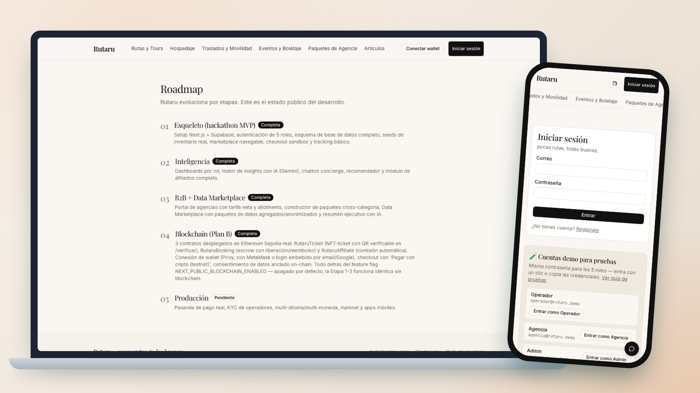
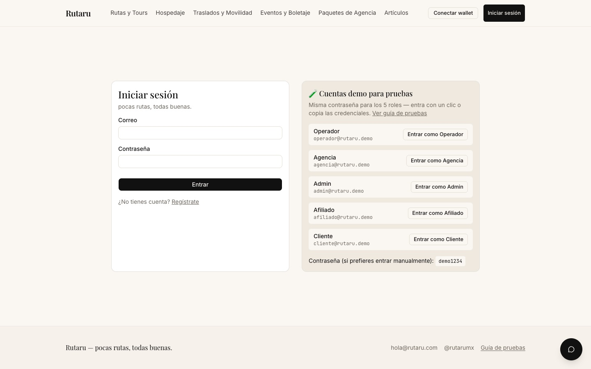
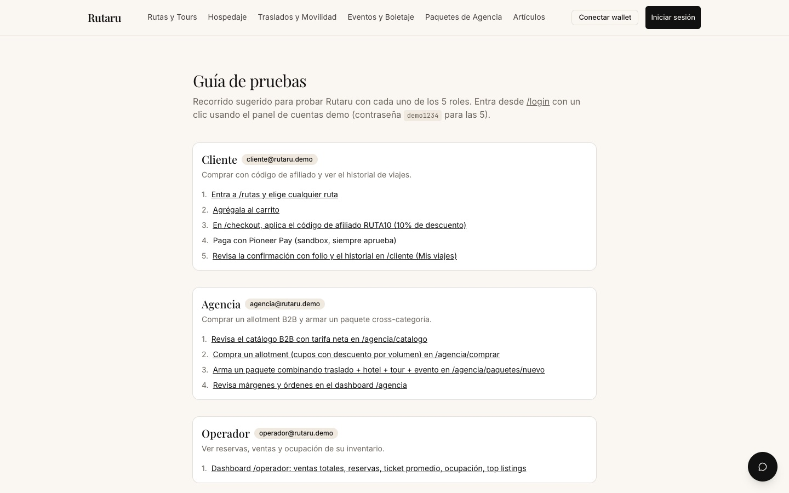
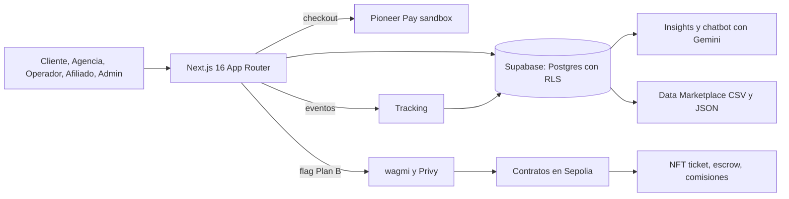

<div align="center">

# Rutaru

### pocas rutas, todas buenas.

Marketplace turístico B2B/B2C (rutas, hospedaje, traslados, eventos y paquetes de agencia) con un motor de inteligencia de datos y un "Plan B" on-chain con escrow y NFT-tickets.

[](#-estado-del-proyecto)
[-d4733a?style=for-the-badge&logo=vercel&logoColor=white)](https://rutaru.vercel.app/roadmap)
[](#-contratos-en-sepolia)


<br/>


<br/>



**[Roadmap en vivo](https://rutaru.vercel.app/roadmap)** · **[Guía de pruebas](https://rutaru.vercel.app/guia-de-pruebas)** · **[Cómo funciona](#-cómo-funciona)** · **[Guía de desarrollo](docs/DESARROLLO.md)**

</div>

> [!WARNING]
> **Proyecto descontinuado, ya no está activo.** El deploy en Vercel sigue publicado, pero solo cargan las páginas que no consultan la base de datos (`/login`, `/registro`, `/roadmap`, `/guia-de-pruebas`). El inicio, el catálogo y los dashboards responden con **error 500**, así que el recorrido completo ya no se puede probar en línea. Los contratos de Sepolia siguen desplegados y verificados en Etherscan. Revisado el 25 de noviembre de 2026.

---

## 🎯 El problema

Los operadores turísticos pequeños venden por WhatsApp y redes, las agencias arman paquetes a mano juntando proveedores, y nadie tiene datos de qué se busca, qué se compra y quién lo vende. Cada actor ve solo su parte.

## 💡 La propuesta

Un solo marketplace con **5 roles** y un dashboard real para cada uno:

| Rol | Qué hace en Rutaru |
|:--|:--|
| **Cliente** | Busca y compra rutas, hospedaje, traslados y eventos; aplica códigos de afiliado; ve su historial |
| **Operador** | Ve reservas, ventas, ticket promedio y ocupación de su inventario |
| **Agencia** | Compra cupos B2B con tarifa neta (allotments) y arma paquetes cross-categoría |
| **Afiliado** | Comparte su código (`/a/[codigo]`), gana comisión y solicita pagos |
| **Admin** | Funnel de conversión, ventas por categoría y destino, insights con IA y Data Marketplace |

Ejemplo del recorrido de la guía de pruebas: el **cliente** entra con un clic, compra una ruta con el código de afiliado `RUTA10` (10 % de descuento), paga con la pasarela sandbox **Pioneer Pay** y recibe un folio; luego el **admin** ve esa venta en su dashboard y en el motor de insights.

## ✨ Funciones principales

- **Marketplace público** con categorías, filtros, detalle de ruta / hotel / evento / traslado / paquete y perfil de operador.
- **Checkout sandbox** (Pioneer Pay, siempre aprueba) con carrito persistido, código de afiliado y comisión.
- **Inteligencia de datos:** tracking de eventos (`page_view`, `search`, `add_to_cart`, `purchase`…), insights generados con **Gemini** (con modo mock si falla), chatbot concierge y recomendador.
- **B2B:** catálogo con tarifa neta oculta por una vista sin esa columna (RLS filtra filas, no columnas), allotments y constructor de paquetes.
- **Data Marketplace:** paquetes de datos agregados y anonimizados, exportables a CSV/JSON, con consentimiento del usuario.
- **Plan B on-chain** (apagado en producción con `NEXT_PUBLIC_BLOCKCHAIN_ENABLED=false`): NFT-ticket verificable con QR en `/verificar/[tokenId]`, escrow que el operador libera o reembolsa, comisión de afiliado pagada on-chain y consentimiento anclado.

<table>
<tr>
<td width="50%"><p align="center"><sub>Inicio de sesión con botón "Entrar como…" para cada uno de los 5 roles.</sub></p></td>
<td width="50%"><p align="center"><sub>Guía de pruebas: recorrido sugerido por rol.</sub></p></td>
</tr>
</table>

<sub>No hay capturas del catálogo ni de los dashboards porque esas páginas ya no cargan en el deploy.</sub>

## 🧠 Cómo funciona



Detalle de carpetas, migraciones, diagrama ER y el patrón de RLS en **[docs/DESARROLLO.md](docs/DESARROLLO.md)** y **[docs/ERD.md](docs/ERD.md)**.

## ⛓️ Contratos en Sepolia

| Contrato | Dirección | Etherscan |
|:--|:--|:--|
| `RutaruTicket` (NFT-ticket) | `0x2eE1d7432DE8E722F5b7597F907aC53b45Ab4aFD` | [código verificado ↗](https://sepolia.etherscan.io/address/0x2eE1d7432DE8E722F5b7597F907aC53b45Ab4aFD#code) |
| `RutaruBooking` (escrow) | `0x81B600E7ACE4CEe5D698C39368B615A732d0E9f8` | [código verificado ↗](https://sepolia.etherscan.io/address/0x81B600E7ACE4CEe5D698C39368B615A732d0E9f8#code) |
| `RutaruAffiliate` (comisiones) | `0x7A237323C37B1bdf32Af7d759078c98866479a0c` | [código verificado ↗](https://sepolia.etherscan.io/address/0x7A237323C37B1bdf32Af7d759078c98866479a0c#code) |

Red de pruebas: los montos son ETH de prueba simbólicos, sin conversión real de MXN. Address y ABI en `src/lib/blockchain/deployments/sepolia.json`. **19 pruebas** de Hardhat (`cd contracts && npx hardhat test`).

## 🛠️ Stack

| Capa | Tecnología |
|:--|:--|
| Web | Next.js 16 (App Router) · React 19 · TypeScript · Tailwind CSS 4 · shadcn/ui · Recharts · Framer Motion |
| Datos | Supabase (Postgres + Auth + RLS), 31 migraciones aplicadas con un script propio |
| IA | Google Gemini (`@google/genai`) detrás de `lib/ai/provider.ts`, con `AI_MODE=live\|mock` |
| Pagos | Pioneer Pay (pasarela sandbox emulada) |
| Web3 | Solidity · Hardhat 3 · ethers.js 6 · wagmi + viem · Privy (MetaMask o login por email/Google) |
| Deploy | Vercel |

## 🚀 Correrlo en tu compu

```bash
npm install
cp .env.example .env.local   # llaves de tu proyecto de Supabase (y Gemini)
npm run db:migrate           # aplica supabase/migrations/ sin Docker
npm run seed:inventory       # rutas, traslados, hospedajes, eventos, paquetes, afiliados
npm run seed:demo-users      # crea los 5 usuarios demo
npm run seed:data-packages   # paquetes de datos para /datos
npm run dev                  # http://localhost:3000
```

<details>
<summary><b>Usuarios demo (los mismos que muestra la pantalla de /login)</b></summary>

| Rol | Correo | Contraseña |
|:--|:--|:--|
| Operador | `operador@rutaru.demo` | `demo1234` |
| Agencia | `agencia@rutaru.demo` | `demo1234` |
| Admin | `admin@rutaru.demo` | `demo1234` |
| Afiliado | `afiliado@rutaru.demo` | `demo1234` |
| Cliente | `cliente@rutaru.demo` | `demo1234` |

</details>

<details>
<summary><b>Probar el Plan B (blockchain) en local</b></summary>

Con `NEXT_PUBLIC_BLOCKCHAIN_ENABLED=true`, una wallet de desarrollo con ETH de Sepolia y las variables de Privy / RPC: conecta la wallet desde el navbar → compra en `/checkout` con "Pagar con cripto (testnet)" → el NFT-ticket se acuña y se verifica en `/verificar/[tokenId]` → desde `/operador`, "Marcar completado" libera el escrow (o "Cancelar y reembolsar"). Pasos completos, faucets y variables en [docs/DESARROLLO.md](docs/DESARROLLO.md#blockchain-plan-b--setup-web3).

</details>

## 📂 Documentación

| Documento | Para qué |
|:--|:--|
| [docs/DESARROLLO.md](docs/DESARROLLO.md) | Arquitectura de carpetas, desarrollo sin Docker y setup Web3 |
| [docs/ERD.md](docs/ERD.md) | Diagrama entidad-relación y patrón de RLS |
| [CHANGELOG.md](CHANGELOG.md) | Detalle de cada etapa y bloque |
| [PROMPT_MAESTRO_RUTARU.md](PROMPT_MAESTRO_RUTARU.md) | Especificación completa del producto |
| [AUDITORIA.md](AUDITORIA.md) | Auditoría de calidad visual y estabilidad (escritorio y móvil, 5 roles) |

## 🗺️ Estado del proyecto

| Etapa | Estado |
|:--|:--|
| 1 · Esqueleto (auth, BD, seeds, marketplace, checkout sandbox, tracking) | Completa |
| 2 · Inteligencia (dashboards, insights con IA, chatbot, recomendador, afiliados) | Completa |
| 3 · B2B + Data Marketplace | Completa |
| 4 · Blockchain Plan B en Sepolia | Completa |
| 5 · Producción (pasarela real, KYC, multi-idioma, mainnet) | No se hizo: el proyecto se descontinuó |

---

<div align="center">

**Rutaru — pocas rutas, todas buenas.**

Desarrollo: **ALFA** · [@ALFA117](https://github.com/ALFA117)

</div>
