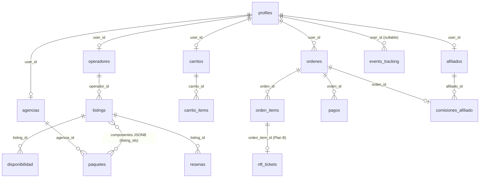

# Rutaru — Diagrama ER (Etapa 1)

Esquema completo creado desde el Bloque 2 (`supabase/migrations/0001`-`0009`). Algunas tablas (`ai_insights`, `data_packages`, `nft_tickets`) existen desde ya pero no tienen lógica de negocio hasta Etapa 2/3/4.

## RLS — 6 plantillas reutilizables

1. **Admin-override universal** — toda política incluye `OR get_user_role(auth.uid()) = 'admin'`.
2. **Dueño directo** (`profiles`, `operadores`, `agencias`, `afiliados`, `carritos`, `ordenes`) — `user_id = auth.uid()` (o `id = auth.uid()` en `profiles`).
3. **Lectura pública / escritura de dueño** (`listings`, `disponibilidad`, `paquetes`, `resenas`) — `SELECT` abierto a `anon`+`authenticated`; escritura restringida por `EXISTS` contra la tabla de dueño.
4. **Hijo de fila propia** (`carrito_items`, `orden_items`, `pagos`, `comisiones_afiliado`) — `EXISTS` subquery contra el padre.
5. **Insert abierto / lectura restringida** (`events_tracking`) — `INSERT` a `anon`+`authenticated`; `SELECT` solo propio o admin.
6. **Admin-only puro** (`ai_insights`, `data_packages`, `nft_tickets`) — todas las operaciones restringidas a `admin`.

`public.get_user_role(uuid)` es `SECURITY DEFINER` para evitar recursión de RLS al leer `profiles` desde otras políticas.

## Migraciones

| Archivo | Contenido |
|---|---|
| `0001_extensions_and_enums.sql` | `pgcrypto`, enums (`user_role`, `listing_tipo`, `orden_tipo`, `orden_estado`, `pago_estado`, `comision_estado`, `data_package_estado`) |
| `0002_core_identity.sql` | `profiles`, `operadores`, `agencias`, `afiliados` |
| `0003_inventory.sql` | `listings`, `disponibilidad`, `paquetes` |
| `0004_commerce.sql` | `carritos`, `carrito_items`, `ordenes`, `orden_items`, `pagos`, `comisiones_afiliado` |
| `0005_content_and_tracking.sql` | `resenas`, `events_tracking` |
| `0006_ai_and_data_future.sql` | `ai_insights`, `data_packages`, `nft_tickets` (esquema completo, sin uso aún) |
| `0007_functions_triggers.sql` | `set_updated_at()` + triggers, `get_user_role()` |
| `0008_rls_policies.sql` | RLS en las 15 tablas |
| `0009_auth_profile_trigger.sql` | `handle_new_user()` — crea `profiles` al registrarse en `auth.users` |

## Cómo se aplicaron (sin Docker)

Sin Docker/Podman disponible en esta máquina, `supabase link`/`db push`/`gen types` (que corren un contenedor `postgres-meta`) no funcionan. En su lugar:

- `npm run db:migrate` (`scripts/db/migrate.mjs`) aplica los 9 archivos de `supabase/migrations/` directo contra Postgres vía el **Session Pooler** (IPv4) de Supabase, usando `SUPABASE_DB_HOST/PORT/USER/PASSWORD/NAME` de `.env.local`.
- `src/types/database.types.ts` se escribió a mano reflejando el esquema exacto de las migraciones (no se pudo generar con `supabase gen types` por la misma razón). Si en el futuro hay Docker disponible, se puede regenerar con `supabase gen types --linked` tras `supabase login` + `supabase link`.

